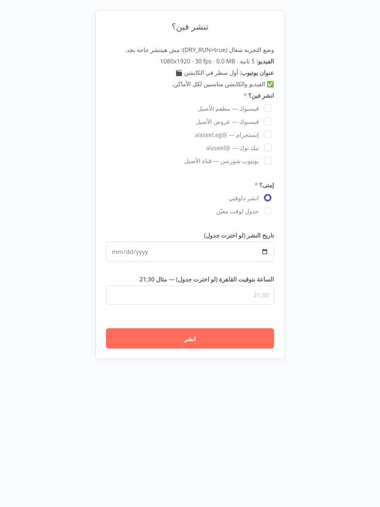
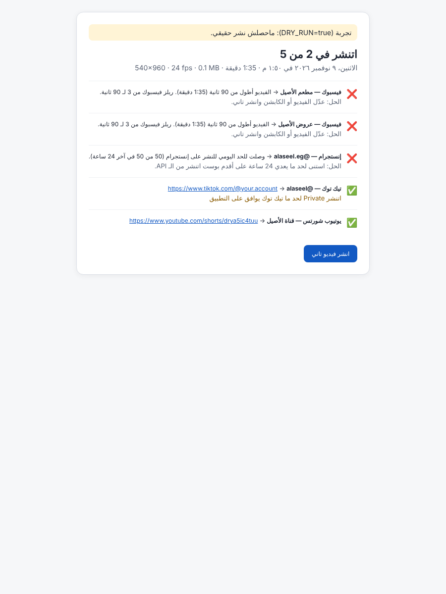

# Social Publisher — ارفع الفيديو مرة وانشره في كل مكان

فورم n8n واحد: ترفع الريل مرة، تكتب الكابشن مرة، تعلّم على الصفحات، تدوس **انشر**، وتشوف النتيجة سطر لكل مكان:
صفحات فيسبوك (Reels) + حسابات إنستجرام (Reels) + تيك توك + يوتيوب شورتس.

بيشتغل **على اللابتوب بس** بـ Docker. تشغّله وقت النشر وتقفله بعدها. مفيش سيرفر ولا اشتراك مدفوع.

> English version: [scroll down](#english).

| صفحة الاختيار (بتتبني من `accounts.json`) | صفحة النتيجة |
|---|---|
|  |  |

---

## الفهرس
1. [أول مرة](#أول-مرة)
2. [الاستعمال اليومي](#الاستعمال-اليومي-4-خطوات)
3. [الإعداد خطوة بخطوة](#الإعداد-خطوة-بخطوة): Meta · Cloudinary · YouTube · TikTok · Telegram · accounts.json
4. [حدود المنصات](#حدود-المنصات-مهم)
5. [الـ workflow بيعمل إيه بالظبط](#الـ-workflow-بيعمل-إيه)
6. [الاختبارات وإيه اللي اتجرب وإيه اللي لأ](#الاختبارات)
7. [المشاكل الشائعة](#المشاكل-الشائعة)
8. [نسخ الـ APIs المستعملة](#نسخ-الـ-apis)

---

## أول مرة

### 1) نزّل Docker Desktop
- من <https://www.docker.com/products/docker-desktop/> نزّل نسخة Windows وسطّبها (هيطلب WSL 2، وافق).
- افتحه واستنى لحد ما يكتب تحت **Engine running**.

### 2) اعمل ملف `.env`
- في فولدر `automation/social-publisher` انسخ `.env.example` وسمّي النسخة `.env`.
  - من Notepad: **File ← Save As** ← **Save as type: All Files** ← الاسم `.env`.
- اعمل `N8N_ENCRYPTION_KEY`: افتح PowerShell واكتب:
  ```powershell
  -join ((48..57)+(97..122) | Get-Random -Count 40 | % {[char]$_})
  ```
  وحط الناتج بعد `N8N_ENCRYPTION_KEY=`.
- ⚠️ **المفتاح ده ماتغيّروش أبدًا.** n8n بيشفّر بيه الـ credentials اللي بيحفظها (زي ربط يوتيوب). لو اتغير أو اتمسح، n8n مش هيعرف يقرا الحاجات المتشفرة وهتضطر تربط يوتيوب من الأول. خد منه نسخة في مكان آمن.
- باقي القيم (التوكنات) هتملاها وانت ماشي في [الإعداد](#الإعداد-خطوة-بخطوة). تقدر تبدأ بـ `DRY_RUN=true` عشان تجرب من غير نشر حقيقي.

### 3) اعمل `accounts.json`
- انسخ `accounts.example.json` وسمّيه `accounts.json` وحط فيه صفحاتك (التفاصيل [هنا](#6-accountsjson)).

### 4) شغّل `start.bat`
- دبل كليك. أول مرة بيحمّل n8n (حوالي 600 ميجا) فهياخد شوية.
- لما يخلص هيفتح المتصفح على `http://localhost:5678`.

### 5) اعمل حساب الـ owner في n8n
- أول مرة n8n هيطلب إيميل وباسورد. ده حساب محلي على جهازك بس.

### 6) استورد الـ workflow
- **أسهل طريقة:** دبل كليك على `import-workflow.bat` (بيستورد `workflow.json` وبيعمله Publish وبيعيد تشغيل n8n).
- **أو يدويًا:** في n8n: **Overview ← Create workflow ← ⋯ (فوق يمين) ← Import from File…** واختار `workflow.json`، وبعدين دوس **Publish**.
- لو هتستعمل يوتيوب: افتح النودين **«يوتيوب: بدء الرفع»** و **«يوتيوب: رفع الفيديو»** واختار في **Credential for YouTube OAuth2 API** الحساب اللي عملته (شوف [YouTube](#3-youtube))، وبعدين **Publish**.

خلاص. الفورم على: **<http://localhost:5678/form/publish>**

---

## الاستعمال اليومي (4 خطوات)
1. شغّل `start.bat`.
2. افتح <http://localhost:5678/form/publish> (بيتفتح لوحده).
3. ارفع الفيديو + اكتب الكابشن ← **التالي** ← علّم على الأماكن ← **انشر**.
4. اقرا النتيجة، وبعدين `stop.bat`.

> لو اخترت **جدول لوقت معيّن**: سيب n8n شغال لحد الميعاد. لو قفلته قبل الميعاد، هيتنشر أول ما تشغّله تاني (اتجرّب).

---

## الإعداد خطوة بخطوة

> أسماء القوايم في مواقع Meta و Google و TikTok بتتغير كتير. الخطوات تحت مكتوبة حسب الدوكيومنتيشن الرسمي بتاريخ نوفمبر 2026، فلو اسم زرار مختلف شوية دوّر على أقرب اسم ليه.

### 1) Meta (فيسبوك + إنستجرام) — حوالي 30–45 دقيقة

**المطلوب قبل ما تبدأ:**
- كل حساب إنستجرام لازم يكون **Professional (Business أو Creator)** و**مربوط بصفحة فيسبوك**. من إنستجرام: **Settings ← Account type and tools ← Switch to professional account**، والربط من **Accounts Center** أو من إعدادات الصفحة.
- لازم تكون **Admin** على الصفحات (أو عندك task: CREATE_CONTENT).

**أ. اعمل التطبيق**
1. ادخل <https://developers.facebook.com/apps> ← **Create App**.
2. اختار نوع **Business** (أو الـ use case اللي فيه إدارة الصفحات و Instagram content publishing).
3. ضيف المنتجات: **Facebook Login for Business** و **Instagram** (Instagram API with Facebook Login).
4. انت كده **Admin** على التطبيق تلقائيًا. لو حد تاني هيستعمله: **App roles ← Roles ← Add People**.

**ب. الصلاحيات المطلوبة** (من الدوكيومنتيشن الحالي):

| المنصة | الصلاحيات |
|---|---|
| Facebook Reels | `pages_show_list`, `pages_read_engagement`, `pages_manage_posts` |
| Instagram (with Facebook Login) | `instagram_basic`, `instagram_content_publish`, `pages_read_engagement` |
| لو الصفحة متضافة لك من Business Manager | ضيف `ads_management` أو `ads_read` (حسب دوكيومنتيشن إنستجرام)، و `business_management` لو الصفحات مش ظاهرة في `me/accounts` |

**ج. هل محتاج App Review؟** — حسب صفحة *Access Levels* و *App Modes*:
- كل الصلاحيات بتاخد **Standard Access** تلقائيًا، و Standard Access بيشتغل مع **أي حد له دور على التطبيق** (وانت Admin). يعني **لصفحاتك وحساباتك انت مش محتاج App Review**.
- ⚠️ **بس خلي بالك:** الدوكيومنتيشن بيقول إن البيانات اللي بتتعمل والتطبيق في **Development mode** (زي البوستات) **بتظهر بس للناس اللي ليهم دور على التطبيق** لحد ما التطبيق يتحول **Live**. فبعد أول نشر حقيقي **افتح البوست من حساب تاني مالوش دور**. لو مش ظاهر، حوّل التطبيق لـ **Live** من الـ toggle اللي فوق في الـ App Dashboard (هيطلب Privacy Policy URL و category). ماقدرتش أتأكد من النقطة دي من غير حسابك الحقيقي.

**د. هات التوكنات والـ IDs من Graph API Explorer**
افتح <https://developers.facebook.com/tools/explorer/>:
1. فوق يمين اختار **Meta App** = تطبيقك، و **User or Page** = *User Token*.
2. من **Permissions** ضيف كل الصلاحيات اللي فوق ← **Generate Access Token** ← وافق واختار **كل الصفحات وحسابات إنستجرام**.
3. ده توكن قصير (ساعة أو اتنين). حوّله لتوكن طويل (60 يوم) بالطلب ده (حط القيم من **App settings ← Basic**):
   ```
   GET oauth/access_token?grant_type=fb_exchange_token&client_id={APP_ID}&client_secret={APP_SECRET}&fb_exchange_token={SHORT_USER_TOKEN}
   ```
4. حط التوكن الطويل في خانة **Access Token** في الـ Explorer واعمل:
   ```
   GET me/accounts?fields=id,name,access_token,instagram_business_account{id,username}
   ```
   - `id` = **pageId**.
   - `access_token` = **Page access token**. لأنه جاي من توكن طويل، فهو **ملوش تاريخ انتهاء** (حسب دوكيومنتيشن *Get Long-Lived Tokens*).
   - `instagram_business_account.id` = **igUserId** لحساب إنستجرام المربوط بالصفحة.
5. اتأكد من كل توكن صفحة في <https://developers.facebook.com/tools/debug/accesstoken/>. لازم يكتب **Expires: Never**.
6. حط كل توكن في `.env`:
   ```
   FB_TOKEN_PAGE_1=EAAG....
   FB_TOKEN_PAGE_2=EAAG....
   ```
   وفي `accounts.json` اكتب اسم المتغير في `tokenEnv`. **إنستجرام بيستعمل توكن الصفحة المربوط بيها**، فبتحط نفس اسم المتغير.

> لو التوكن اتلغى (غيّرت باسورد فيسبوك، شلت التطبيق، أو اتشالت صلاحيتك على الصفحة)، النتيجة هتقولك «التوكن خلص» وهتعيد خطوة (د).

### 2) Cloudinary — 5 دقايق
إنستجرام مابيقبلش رفع ملف من جهازك. لازم يسحب الفيديو من **رابط https عام**، واللابتوب مش عام. فبنرفع الفيديو على Cloudinary مؤقتًا وبنمسحه بعد النشر.
1. اعمل حساب مجاني على <https://cloudinary.com/users/register_free>.
2. من **Console ← Settings ← API Keys** (أو الـ Dashboard) خد **Cloud name** و **API Key** و **API Secret**.
3. حطهم في `.env`:
   ```
   CLOUDINARY_CLOUD_NAME=...
   CLOUDINARY_API_KEY=...
   CLOUDINARY_API_SECRET=...
   ```
- الرفع **signed** (التوقيع بيتحسب جوه n8n، والـ secret مابيخرجش من جهازك).
- الملفات اللي أكبر من 20 ميجا بتترفع chunks (Cloudinary بيطلب chunks لأي حاجة فوق 100 ميجا).
- بعد ما كل حاجة تخلص النسخة بتتمسح. لو عايز تحتفظ بيها: `"keepCloudCopy": true` في `accounts.json`.
- حد حجم الفيديو في الخطة المجانية شوفه في الـ Console (ماقدرتش أتأكد منه من صفحة الأسعار).

### 3) YouTube — حوالي 20 دقيقة
1. ادخل <https://console.cloud.google.com/> ← اعمل **New Project**.
2. **APIs & Services ← Library** ← دوّر على **YouTube Data API v3** ← **Enable**.
3. **APIs & Services ← OAuth consent screen** (أو **Google Auth Platform**):
   - User type: **External**.
   - ضيف إيميلك في **Test users** (أو **Audience ← Test users**).
4. **APIs & Services ← Credentials ← Create Credentials ← OAuth client ID**:
   - Application type: **Web application**.
   - **Authorized redirect URIs**: `http://localhost:5678/rest/oauth2-credential/callback`
     (هو نفس الـ **OAuth Redirect URL** اللي n8n بيعرضه في شاشة الـ credential. انسخه من هناك عشان تتأكد.)
   - خد **Client ID** و **Client secret**.
5. في n8n: **Overview ← Credentials ← Create credential ← YouTube OAuth2 API** ← حط الـ Client ID و Secret ← **Sign in with Google** ← اختار القناة ← وافق. سمّيه **YouTube account**.
6. اختار الـ credential ده في النودين **«يوتيوب: بدء الرفع»** و **«يوتيوب: رفع الفيديو»** ← **Publish**.

**مهم:**
- **الحصة اليومية (اتغيرت):** صفحة *videos.insert* و *Quota costs* الحالية بتقول إن الرفع بقى ليه **bucket لوحده: 100 رفع في اليوم، وكل رفع بـ 1**، منفصل عن الـ 10,000 وحدة بتوع باقي الطلبات. يعني الكلام القديم عن «6 رفعات في اليوم بسبب 1600 وحدة» **مابقاش صحيح**. الحصة بتتجدد 12 بالليل بتوقيت المحيط الهادي (حوالي 10 الصبح بتوقيت مصر).
- **الخصوصية:** نفس الصفحة بتقول إن الفيديوهات من مشاريع API غير موثّقة **مابقتش بتتقفل private إجباري**. الخصوصية من `youtube.privacyStatus` (الافتراضي `public`).
- **ربط يوتيوب بيخلص كل 7 أيام** طول ما الـ consent screen في وضع **Testing** (مذكور في دوكيومنتيشن Google OAuth). الحل: إما تعمل **Reconnect** للـ credential كل أسبوع، أو **Publish app** (تحويله In production). لما تعمل Publish، جوجل هيوريك شاشة «unverified app» تعدّيها بـ Advanced. ماقدرتش أجرّب ده على حسابك.
- يوتيوب بيعتبر الفيديو **Short** لو طولي أو مربع و **3 دقايق أو أقل**. الفورم بينبّهك لو مش كده.

### 4) TikTok — 30 دقيقة + انتظار مراجعة التطبيق
**أ. اعمل التطبيق**
1. <https://developers.tiktok.com/> ← سجّل دخول ← **Manage apps ← Connect an app / Create app**.
2. املا بيانات التطبيق (اسم، أيقونة، وصف، Terms of Service URL، Privacy Policy URL).
3. **Add products**: ضيف **Login Kit** و **Content Posting API**.
4. في Content Posting API فعّل **Direct Post**.
5. **Scopes**: `user.info.basic` و `video.publish` (`video.upload` بيبعت draft للـ inbox مش نشر مباشر، فمش محتاجينه).
6. في **Login Kit ← Redirect URI** حط رابط **https** انت بتملكه، مثلًا `https://<موقعك>/tiktok-callback/`.
   - **ليه مش localhost؟** دوكيومنتيشن Login Kit for Web بيقول إن الـ redirect URI لازم يكون **absolute ويبدأ بـ https**، و n8n عندك `http://localhost`.
   - الحل: الصفحة **مش لازم تكون موجودة** (عادي تطلع 404). المهم إن تيك توك هيحوّلك عليها و**الكود هيبقى في شريط العنوان**، فتنسخه وتلصقه في فورم الربط.
   - ماقدرتش أتأكد إن تيك توك بيقبل redirect لصفحة مش موجودة من غير حسابك. لو رفض، اعمل صفحة فاضية على موقعك.
7. حط في `.env`:
   ```
   TIKTOK_CLIENT_KEY=...
   TIKTOK_CLIENT_SECRET=...
   TIKTOK_REDIRECT_URI=https://<موقعك>/tiktok-callback/
   ```
   (لازم يكون **مطابق حرف بحرف** للي في Login Kit.)
8. ابعت التطبيق للمراجعة العادية لو البورتال طلب ده عشان المنتجات تشتغل، أو استعمل **Sandbox** وضيف حسابك كـ target user. (ماقدرتش أتأكد من تفاصيل الـ Sandbox من الدوكيومنتيشن اللي قريته.)

**ب. اربط حسابك**
1. شغّل n8n وافتح <http://localhost:5678/form/tiktok-connect> ← **ابدأ**.
2. دوس **اربط حساب تيك توك** ← وافق ← هتتحوّل على الـ redirect URI.
3. انسخ **الرابط كله** من شريط العنوان والصقه ← **احفظ الربط**.
- التوكن بيتحفظ في `data/tiktok-token.json` (متجاهل في git).
- الـ access token بيعيش **ساعتين** والـ refresh token **180 يوم**. التجديد بيحصل لوحده قبل كل نشر، وكل تجديد بيرجّع **refresh token جديد** (rotation)، والـ workflow بيحفظ الجديد كل مرة.
- بعد 180 يوم (أو لو التوكن اتلغى) النتيجة هتقولك «اربط تاني».
- **ليه مش n8n OAuth2 credential؟** تيك توك بيطلب `client_key` مش `client_id` في الطلبات، و credential الـ OAuth2 العام في n8n بيبعت `client_id`. وكمان الـ refresh token بيتغير كل مرة. فعملت الربط بفورم صغير بيحفظ التوكن ويجدده بنفسه.

**ج. حدود ما قبل المراجعة (audit) — مهم جدًا**
من *Content Sharing Guidelines* و *Direct Post*:
- كل البوستات من تطبيق **ماعداش الـ audit** بتتنشر **SELF_ONLY (Private)**. عشان كده `privacyLevel` في `accounts.json` = `SELF_ONLY`، والنتيجة بتكتب: **«اتنشر Private لحد ما تيك توك يوافق على التطبيق»**.
- **حساب تيك توك نفسه لازم يكون Private وقت النشر** (التطبيق غير المراجَع بيرجّع `unaudited_client_can_only_post_to_private_accounts` لو الحساب public). من التطبيق: **Settings and privacy ← Privacy ← Private account**.
- أقصى **5 حسابات في 24 ساعة** للتطبيق غير المراجَع، وحوالي **15 بوست في اليوم لكل حساب** لكل الـ APIs.
- بعد النشر تقدر تخلي الفيديو public يدوي: خلّي الحساب Public، وبعدين غيّر خصوصية الفيديو لـ Everyone.

**د. التقديم على الـ audit**
- من صفحة التطبيق ← **Content Posting API ← Direct Post ← Apply for audit / Submit for review**. هيطلب وصف للاستعمال، فيديو بيوري الـ UX، وتقدير عدد المستخدمين.
- ⚠️ **بصراحة:** الـ guidelines بتقول صراحة إن من الاستعمالات **غير المقبولة**: «A utility tool to help upload contents to the account(s) you or your team manages»، وإن التطبيق لازم يكون لجمهور واسع مش استعمال شخصي. فالأغلب إن الـ audit **هيترفض** لأداة شخصية زي دي. كمان فيه شروط UX إجبارية (اختيار الخصوصية من غير default، checkboxes للتعليقات و Duet و Stitch، إقرار Music Usage، معاينة) مش موجودة في الفورم البسيط ده.
- يعني الأقرب للواقع: **تيك توك هيفضل Private**، وتفتح التطبيق وتخلّي الفيديو public بإيدك (ثواني).
- لو اتقبلت بعد كده: غيّر `"privacyLevel": "PUBLIC_TO_EVERYONE"` في `accounts.json`.

### 5) Telegram (اختياري) — 5 دقايق
1. في تيليجرام كلّم **@BotFather** ← `/newbot` ← خد الـ **token**.
2. ابعت أي رسالة للبوت بتاعك.
3. افتح `https://api.telegram.org/bot<TOKEN>/getUpdates` في المتصفح وخد `"chat":{"id": ...}`.
4. في `.env`: `TELEGRAM_BOT_TOKEN=...` و `TELEGRAM_CHAT_ID=...`. لو فاضيين التليجرام بيتقفل لوحده.

### 6) `accounts.json`
```json
{
  "settings": { "graphApiVersion": "v27.0", "keepCloudCopy": false, "pollTimeoutMinutes": 10, "igShareToFeed": true },
  "facebookPages": [
    { "name": "مطعم الأصيل", "pageId": "100000000000001", "tokenEnv": "FB_TOKEN_PAGE_1" },
    { "name": "عروض الأصيل", "pageId": "100000000000002", "tokenEnv": "FB_TOKEN_PAGE_2" }
  ],
  "instagramAccounts": [
    { "name": "@alaseel.eg", "igUserId": "17841400000000001", "tokenEnv": "FB_TOKEN_PAGE_1" }
  ],
  "tiktok":  { "enabled": true, "name": "@alaseel", "privacyLevel": "SELF_ONLY" },
  "youtube": { "enabled": true, "name": "قناة الأصيل", "privacyStatus": "public", "categoryId": "22", "madeForKids": false }
}
```
(الأرقام دي وهمية.)

**تضيف صفحة جديدة:**
1. هات الـ `pageId` والتوكن بتاعها (خطوة Meta د).
2. ضيف في `.env` سطر زي `FB_TOKEN_PAGE_3=...`.
3. ضيف في `facebookPages`: `{ "name": "اسم الصفحة", "pageId": "...", "tokenEnv": "FB_TOKEN_PAGE_3" }`.
4. `stop.bat` ثم `start.bat` (عشان `.env` يتقري تاني).

- تقفل صفحة من غير ما تمسحها: `"enabled": false`.
- **مفيش حاجة تتعدل في الـ nodes.** صفحة الاختيار بتتبني من الملف ده كل مرة.
- لو الملف فيه غلطة، الفورم هيقولك فين بالعربي.

| الإعداد | المعنى |
|---|---|
| `graphApiVersion` | نسخة Graph API (`v27.0`) |
| `keepCloudCopy` | `true` = ماتمسحش الفيديو من Cloudinary بعد النشر |
| `pollTimeoutMinutes` | أقصى انتظار لمعالجة فيسبوك/إنستجرام/تيك توك (افتراضي 10) |
| `igShareToFeed` | الريل يظهر في الـ Feed كمان |
| `tiktok.privacyLevel` | `SELF_ONLY` لحد الـ audit |
| `youtube.privacyStatus` | `public` / `unlisted` / `private` |

---

## حدود المنصات (مهم)

| المنصة | الحد | المصدر |
|---|---|---|
| فيسبوك Reels | **30 ريل من الـ API لكل صفحة في 24 ساعة**. الفيديو 3–90 ثانية، 9:16، أقل حاجة 540x960، 24–60 fps | Reels Publishing API |
| إنستجرام | **100 بوست API في 24 ساعة** حسب *Content Publishing*، لكن صفحة *content_publishing_limit* بتقول `quota_total` = 50. الـ workflow **بيسأل إنستجرام عن الرقم الحقيقي قبل كل نشر** ولو خلص بيقولك: «وصلت للحد اليومي للنشر على إنستجرام (x من y)». الريل 3 ثواني – 15 دقيقة، أقصى 300 ميجا، كابشن 2200 حرف، 30 هاشتاج، 20 منشن | IG Content Publishing |
| تيك توك | **Private بس لحد الـ audit**، الحساب لازم يكون Private، 5 حسابات/يوم للتطبيق، حوالي 15 بوست/يوم للحساب، 6 طلبات init في الدقيقة | TikTok Content Sharing Guidelines |
| يوتيوب | **100 رفع/يوم** (bucket منفصل، كل رفع = 1). العنوان 100 حرف، الوصف 5000 بايت | YouTube Data API videos.insert |

---

## الـ workflow بيعمل إيه

```
[فورم 1: فيديو + كابشن + هاشتاج + عنوان]
  → حفظ الفيديو في data/uploads  → تجهيز (قراءة accounts.json + فحص الفيديو + الكابشن)
  → [فورم 2 (بيتبني من accounts.json): الأماكن + دلوقتي/جدول + ملخص الفحص]
  → خطة النشر (مكان = item)
  → (لو مجدول: تشغيل في الخلفية → Wait للميعاد)
  → فيسبوك → Cloudinary (لو فيه إنستجرام) → إنستجرام → تيك توك → يوتيوب (HTTP + n8n credential)
  → تجميع → مسح النسخة المؤقتة + اللوج + تيليجرام → [صفحة النتيجة]
```
- **كل منصة مستقلة:** كل نود بيمسك أخطاءه، والفشل بيتسجل ❌ على المكان ده بس والباقي بيكمل.
- **الفحص قبل النشر:** المدة والأبعاد والجودة والـ fps والحجم (فاحص MP4/MOV مكتوب بـ JavaScript، لأن صورة n8n مافيهاش ffprobe) + طول الكابشن وعدد الهاشتاجات والمنشن لكل منصة. لو فيه مشكلة في منصة معينة، بتظهر في صفحة الاختيار، ولو اخترتها بتتسجل ❌ بالسبب (مثلًا «الفيديو أطول من 90 ثانية») من غير ما توقف الباقي.
- **صفحة النتيجة:** `✅ الاسم → الرابط` أو `❌ الاسم → السبب — الحل`.
- **اللوج:** سطر JSON لكل نشر في `logs/YYYY-MM.jsonl` (التاريخ، الكابشن، معلومات الفيديو، النتايج والروابط).
- **الأسرار:** في `.env` (التوكنات) أو في n8n credentials (يوتيوب) أو `data/tiktok-token.json`. كلهم متجاهلين في git.

### التجربة من غير نشر (`DRY_RUN`)
- في `.env`: `DRY_RUN=true` ← كل منصة بترجع نجاح وهمي، ومفيش أي طلب بيخرج.
- تقدر تخلي مكان يفشل عمدًا: `DRY_RUN_FAIL=tiktok` (أو `instagram`، أو `fb:<pageId>`، أو الاسم بالظبط). الفشل الوهمي بيعدّي على نفس رسائل الأخطاء الحقيقية.
- بعد ما تغيّر `.env`: `stop.bat` ثم `start.bat`.

---

## الاختبارات
```bash
cd automation/social-publisher
npm test           # 56 unit test (Node 20+، من غير أي dependencies)
npm run build      # بيبني workflow.json من src/nodes + lib
```
- **Unit tests** (`test/*.test.js`): بناء الكابشن والهاشتاج لكل منصة، قص عنوان يوتيوب (من غير ما يكسر الإيموجي)، فحص الفيديو (فيديوهات حقيقية صغيرة في `test/fixtures`، منها `.mov` موبايل متلف)، قراءة `accounts.json`، تحويل الأخطاء لعربي، الجدولة بتوقيت القاهرة (شتوي/صيفي)، توقيع Cloudinary (بالأمثلة اللي في دوكيومنتيشن Cloudinary نفسه)، تقسيم chunks تيك توك، وتدفقات كل منصة ضد **mock server** معمول على شكل الطلبات والردود اللي في الدوكيومنتيشن (`test/mock-server.js`).
- **End-to-end في n8n 2.46.7 حقيقي (Docker، نفس `docker-compose.yml`)**، والفورم اتملى بـ Chromium (`test/e2e/*.js`):
  - الاستيراد والـ Publish من غير أخطاء، وكل الـ nodes اتعرفت.
  - **DRY_RUN:** فيديو 95 ثانية لـ 5 أماكن: فيسبوك ❌ «أطول من 90 ثانية» (صفحتين)، تيك توك ❌ (فشل عمدًا)، إنستجرام ✅، يوتيوب ✅. صفحة النتيجة واللوج طلعوا صح، والملف المؤقت اتمسح.
  - **ضد الـ mock APIs (كود النشر الحقيقي):** صفحة ✅، صفحة بتوكن منتهي ❌ «التوكن خلص… FB_TOKEN_PAGE_2»، إنستجرام ✅ عن طريق Cloudinary (signed، واتمسح بعدها)، تيك توك ✅ (تجديد التوكن + حفظ الـ refresh الجديد + Private)، يوتيوب ✅ عن طريق n8n credential، والتيليجرام اتبعت.
  - **فيديو 150 ميجا:** كله نجح في 37 ثانية. Cloudinary اترفع 8 chunks، تيك توك 15 chunk، وفيسبوك ويوتيوب stream كامل. الميموري ثابتة.
  - **الجدولة:** اتنشر في الميعاد بالظبط، وكمان لما n8n **اتقفل قبل الميعاد واشتغل بعده**، التشغيل المجدول كمّل أول ما n8n اشتغل.
  - **ربط تيك توك:** الرابط اتعمل، والكود اتبدل وانحفظ، ورابط بـ state غلط اترفض.

### اللي **ماينفعش يتجرب من غير حساباتك الحقيقية**
- أي نشر حقيقي على فيسبوك وإنستجرام وتيك توك ويوتيوب (الـ mock بيقلّد الدوكيومنتيشن، مش السيرفرات نفسها).
- هل بوستات تطبيق Meta في Development mode بتظهر للناس ولا لأ.
- رابط الريل الراجع من فيسبوك (`permalink_url`): لو مارجعش بنستعمل `facebook.com/reel/{id}`.
- رسائل الخطأ الحقيقية اللي بترجع من كل منصة (الأكواد المعروفة متترجمة، وأي حاجة تانية بتظهر برسالة المنصة نفسها).
- إن تيك توك يقبل redirect URI لصفحة مش موجودة، وتفاصيل الـ Sandbox ومراجعة التطبيق.
- حد حجم Cloudinary المجاني، ورفع فيديو حقيقي لـ Cloudinary.
- تشغيل `start.bat` / `stop.bat` على Windows (اتكتبوا لـ Windows لكن الاختبار كان على Linux بنفس الـ docker compose).

---

## المشاكل الشائعة
| المشكلة | الحل |
|---|---|
| `start.bat` بيقول Docker مش شغال | افتح Docker Desktop واستنى **Engine running** |
| الفورم بيقول accounts.json فيه غلطة | الرسالة بتقول السطر/الحقل. اتأكد من الفواصل والأقواس |
| «التوكن خلص» | خطوة Meta (د) تاني ← `.env` ← stop/start |
| يوتيوب «n8n مش لاقي حساب يوتيوب» | اختار الـ credential في النودين ← Publish |
| يوتيوب «ربط يوتيوب خلص» | Credentials ← YouTube account ← Reconnect (كل 7 أيام في وضع Testing) |
| تيك توك «unaudited… private accounts» | خلّي حساب تيك توك Private |
| إنستجرام «رفض الفيديو أثناء المعالجة» | صدّر الفيديو MP4 (H.264 + AAC) 1080x1920 30fps مع faststart |
| غيّرت `N8N_ENCRYPTION_KEY` بالغلط | رجّع القديم. لو ضاع: اعمل credential يوتيوب جديد |
| عايز تشوف تفاصيل تنفيذ | n8n ← الـ workflow ← **Executions** |

**تحديث n8n:** غيّر رقم النسخة في `docker-compose.yml` ← `docker compose pull` ← `start.bat`. البيانات في الـ volume `social_publisher_n8n_data` مش بتتمسح.

---

## نسخ الـ APIs
اتراجعت من الدوكيومنتيشن الرسمي في **9 نوفمبر 2026**:

| الحاجة | النسخة / الـ endpoint |
|---|---|
| n8n | **2.46.7** (`stable`/`latest` على npm). Form Trigger 2.5، Form 2.5، HTTP Request 4.2، Code 2، Merge 3.2، Wait 1.1 |
| Meta Graph API | **v27.0** (أحدث نسخة حسب Graph API Changelog). تتغير من `settings.graphApiVersion` |
| Facebook Reels | `POST /{page-id}/video_reels` (start/finish) + `POST rupload.facebook.com/video-upload/v27.0/{video-id}` + `GET /{video-id}?fields=status` |
| Instagram | Instagram API with Facebook Login، host `graph.facebook.com`: `/{ig-user-id}/media` (REELS) ← `/{container-id}?fields=status_code` ← `/{ig-user-id}/media_publish` ← `?fields=permalink`، و `/content_publishing_limit` |
| TikTok | Content Posting API v2: `/v2/post/publish/creator_info/query/`، `/v2/post/publish/video/init/` (FILE_UPLOAD)، PUT chunks، `/v2/post/publish/status/fetch/`، OAuth `/v2/oauth/token/` |
| YouTube | Data API **v3** resumable upload `POST /upload/youtube/v3/videos?uploadType=resumable&part=snippet,status` ← PUT |
| Cloudinary | Upload API `POST /v1_1/{cloud}/video/upload` (signed SHA-1، chunked)، `POST /v1_1/{cloud}/video/destroy` |
| Telegram | Bot API `sendMessage` (Bot API 10.3) |

### ملاحظات تقنية
- كل الكود في Code nodes متكتب في `lib/` و `src/nodes/`، و `npm run build` بيحطه جوه `workflow.json`، لأن الـ task runner في n8n 2.x مابيسمحش بـ `require` لملفات محلية. **ماتعدلش الكود جوه n8n.** عدّل الملفات وابني تاني.
- الرفع بيستعمل `http/https` بتوع Node مباشرة: جرّبت `this.helpers.httpRequest` من Code node، والـ Buffer اتحول JSON في الطريق (30 ميجا وصلوا 107 ميجا).
- `N8N_RUNNERS_TASK_TIMEOUT=3600` لأن الـ default (300 ثانية) ممكن يقطع رفع كبير أو معالجة إنستجرام.
- إنستجرام دلوقتي بيدعم كمان رفع مباشر (`upload_type=resumable` على rupload) من غير رابط عام. الخطوة دي ممكن تشيل الحاجة لـ Cloudinary في المستقبل، بس سبت Cloudinary زي ما اتطلب.

---

<a name="english"></a>
# English

**What it is:** an n8n workflow you run locally with Docker. One form: upload the video once, write the caption once, tick Facebook Pages / Instagram accounts / TikTok / YouTube Shorts, press publish, and get a per-destination result page (✅ link / ❌ reason + fix in Egyptian Arabic). There's also a Telegram summary (optional) and a JSONL log in `logs/YYYY-MM.jsonl`.

## First run
1. Install Docker Desktop (WSL 2) and wait for *Engine running*.
2. Copy `.env.example` → `.env`. Set `N8N_ENCRYPTION_KEY` once and never change it: n8n encrypts saved credentials with it, so a new key makes them unreadable and you'd have to reconnect YouTube.
3. Copy `accounts.example.json` → `accounts.json` and list your pages/accounts.
4. Double-click `start.bat`. It opens `http://localhost:5678`.
5. Create the n8n owner account.
6. Double-click `import-workflow.bat` (or *Import from File…* → `workflow.json` → **Publish**). If you use YouTube, select your YouTube OAuth2 credential on the two YouTube HTTP nodes and **Publish** again.

## Daily use
1. `start.bat`.
2. Open <http://localhost:5678/form/publish>.
3. Upload + caption → Next → tick destinations → Publish.
4. Read the results, then `stop.bat`.

## Setup summary
- **Meta:** Business app with Facebook Login for Business + Instagram (Facebook Login). Permissions: `pages_show_list`, `pages_read_engagement`, `pages_manage_posts`, `instagram_basic`, `instagram_content_publish` (+ `ads_management`/`ads_read` if your Page role comes from Business Manager; `business_management` if pages don't show up). All permissions get Standard Access automatically, which works for people with a role on the app, so **no App Review is needed for your own assets**. However, the docs say content created while the app is in **Development mode is only visible to app-role users**, so check a post from another account and switch the app to **Live** if needed (unverified without your account). In Graph API Explorer: short user token → `GET oauth/access_token?grant_type=fb_exchange_token&client_id=…&client_secret=…&fb_exchange_token=…` → `GET me/accounts?fields=id,name,access_token,instagram_business_account{id,username}`. Page tokens from a long-lived user token don't expire. Put each in `.env` and reference the variable name in `accounts.json` → `tokenEnv`. Instagram uses the token of its linked Page.
- **Cloudinary:** a free account. Put the cloud name, API key and secret in `.env`. Uploads are signed, and files over 20 MB are chunked. The copy is deleted after publishing unless `keepCloudCopy: true`.
- **YouTube:** a Google Cloud project with YouTube Data API v3 enabled, an External consent screen with you as a test user, and a Web OAuth client with redirect `http://localhost:5678/rest/oauth2-credential/callback`. Then create an n8n *YouTube OAuth2 API* credential. Quota: `videos.insert` now has its **own bucket of 100 uploads/day (1 unit each)**, so the old "≈6 uploads/day" no longer applies. Uploads from unverified projects are no longer forced private. Refresh tokens expire after **7 days** while the consent screen is in *Testing*.
- **TikTok:** an app with Login Kit + Content Posting API (Direct Post) and scopes `user.info.basic,video.publish`. The redirect URI **must be https**, so use a URL you own; the page can 404, because you paste the resulting URL into `http://localhost:5678/form/tiktok-connect`. Tokens live in `data/tiktok-token.json`: access token 2 h, refresh token 180 days, rotated on every refresh, refreshed automatically. Until the app passes TikTok's audit, posts are **SELF_ONLY** and the TikTok account must be **private**. The audit guidelines explicitly list "a utility tool to upload content to accounts you or your team manage" as not acceptable, so expect TikTok to stay private.
- **Telegram (optional):** get a token from @BotFather and a chat id from `getUpdates`.

## Tests
`npm test` runs 56 unit tests: captions/hashtags, title truncation, MP4/MOV probing incl. rotated phone video, config parsing, Arabic error mapping, Cairo-time scheduling, Cloudinary signatures (doc test vectors), TikTok chunking, and each platform flow against a mock built from the documented request/response shapes.

End-to-end runs were done in real n8n 2.46.7 under Docker, driven by Chromium: dry-run, one-platform-fails, mock-API run of the real code, a 150 MB file, a scheduled post (including n8n being stopped across the scheduled time), and TikTok connect.

**Not testable without your accounts:** real publishing on any platform, Development-mode visibility on Meta, the real FB permalink, real platform error texts, TikTok's acceptance of a non-existent redirect page, the Cloudinary free-plan size limit, and running the `.bat` files on Windows.

## API versions (checked 2026-11-09)
n8n 2.46.7 · Meta Graph API v27.0 · TikTok Content Posting API v2 · YouTube Data API v3 · Cloudinary Upload API v1_1 · Telegram Bot API 10.3.
